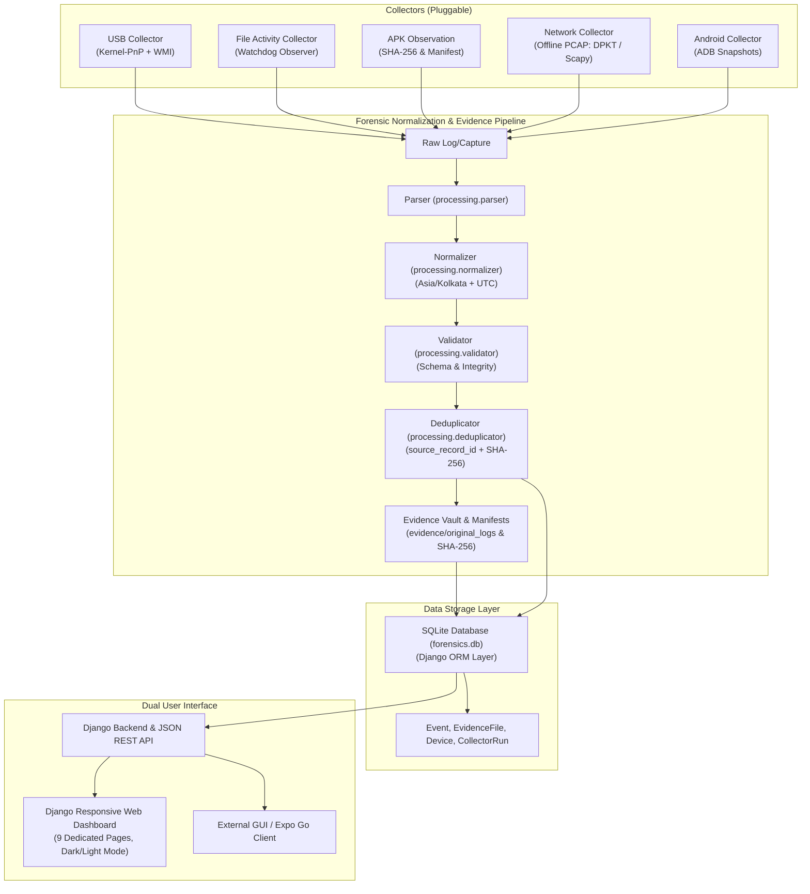

# HPC-Accelerated AI-Enhanced Digital Forensics and Behavioral Analysis System (Stage 1)

[](https://www.python.org/)
[](https://www.djangoproject.com/)
[-brightgreen.svg)](tests/)
[](LICENSE)

A modular, multi-source digital forensics collection, evidence verification, and timeline reconstruction platform.

Stage 1 establishes the forensic data ingestion foundation, event normalization pipeline, cryptographic chain-of-custody vault, and multi-source chronological timeline visualization.

---

## High-Level Architecture



---

## Key Features

- **Multi-Source Collection**:
  - **USB Collector**: Monitors Windows Kernel-PnP and WMI for USB arrival (`usb_connected`) and removal (`usb_disconnected`) events with Vendor ID (VID) and Product ID (PID) parsing.
  - **File Activity Collector**: Observes dedicated folder `test_data/watched_downloads/` using `watchdog`, handles browser temp files (`.crdownload`, `.part`), awaits write stability, and computes SHA-256.
  - **APK Observation**: Identifies `.apk` files on the host system without executing them.
  - **Android Emulator Collector**: Interrogates Android Studio Emulators via ADB, captures baseline third-party packages, and detects controlled installations through before/after snapshot diffing.
  - **Network Collector**: Ingests PCAP and PCAPNG capture files offline using pure Python `dpkt` and `scapy`, extracting IPs, ports, protocols, TCP flags, and DNS queries.
- **Forensic Pipeline**:
  - Timezone-aware normalization (UTC storage, `Asia/Kolkata` local display).
  - Strict preservation of raw timestamps without fabrication.
  - Two-tier deduplication via `source_record_id` and SHA-256 hash.
- **Evidence Management & Chain of Custody**:
  - Pristine evidence vault (`evidence/original_logs/`).
  - Formatted identifiers (`EVD-...` and `EVT-...`).
  - Live cryptographic SHA-256 re-verification to detect file tampering.
- **Unified Chronological Timeline**:
  - Multi-source chronological view with newest-first ordering.
  - Multi-attribute filtering (event type, date range, source, free-text search).
  - Pagination (25 events/page) and one-click RFC-4180 CSV export.
- **Dual User Interface**:
  - 9 responsive web dashboard pages (Overview, Network, USB, Files, Android, Timeline, Evidence, Collectors, Reports).
  - Headless REST JSON API (`/api/stats/`, `/api/events/`, `/api/evidence/`, `/api/collectors/`).

---

## Directory Structure

```
Network-Log-Intelligence/
├── .venv/                         # Isolated Python virtual environment
├── api_app/                       # Headless JSON REST API application
├── collectors/                    # Forensic data collector modules
│   ├── base_collector.py          # Abstract base class with lifecycle & audit tracking
│   ├── usb_collector.py           # Windows PnP / WMI USB event harvester
│   ├── file_collector.py          # Watchdog filesystem observer
│   ├── network_collector.py       # Offline PCAP/PCAPNG ingestion engine
│   └── android_collector.py       # ADB Android package snapshot observer
├── config/                        # Configuration settings
│   └── settings.yaml              # Central configuration file
├── dashboard/                     # Django Web Dashboard
│   ├── templates/dashboard/       # 9 Bootstrap 5.3 templates (dark/light themes)
│   ├── static/                    # CSS stylesheets and UI assets
│   ├── urls.py                    # Dashboard URL routing
│   └── views.py                   # 9 controller views
├── database/                      # Data Access Repository Layer
│   └── repositories.py            # EventRepository, EvidenceRepository, CollectorRunRepository
├── database_app/                  # Django ORM application
│   ├── models.py                  # Event, EvidenceFile, Device, CollectorRun models
│   └── migrations/                # Database migration history
├── documentation/                 # 16 Comprehensive Forensic & Technical Guides
│   ├── architecture.md            # System architecture and data flow
│   ├── installation.md            # Installation and setup instructions
│   ├── verify_environment.md      # Environment diagnostic guide
│   ├── database_schema.md         # Database tables and entity relationships
│   ├── collector_architecture.md  # Collector lifecycle and worker threads
│   ├── usb_testing_guide.md       # Windows PnP USB testing guide
│   ├── file_monitoring_guide.md   # Filesystem monitoring guide
│   ├── android_emulator_guide.md  # ADB emulator testing guide
│   ├── network_capture_guide.md   # Network capture and PCAP ingestion guide
│   ├── evidence_integrity_guide.md# Cryptographic hashing & chain-of-custody guide
│   ├── dashboard_user_guide.md    # Web dashboard user walkthrough
│   ├── troubleshooting_guide.md   # Diagnostic and error remediation guide
│   ├── limitations.md             # Forensic boundary and technical non-claims
│   ├── testing_report.md          # 34-test automated verification report
│   └── stage1_completion_report.md# Final Stage 1 sign-off report
├── evidence/                      # Forensic Evidence Storage Vault
│   ├── original_logs/             # Pristine unaltered original files
│   ├── manifests/                 # Evidence manifests and checksums
│   └── processed/                 # Working copies for parsing
├── forensics_core/                # Django project core configuration
│   ├── settings.py                # Django settings (timezones, databases, security)
│   └── urls.py                    # Root URL router
├── scripts/                       # PowerShell automation scripts
│   ├── install_requirements.ps1   # Repeatable environment installer
│   ├── verify_environment.ps1     # Environmental diagnostic tool
│   ├── create_test_samples.py     # Generates harmless test fixtures
│   └── run_project.ps1            # Project orchestrator launcher
├── test_data/                     # Isolated test fixtures
│   ├── watched_downloads/         # Dedicated download observation directory
│   ├── network_samples/           # Synthetic sample PCAP files
│   ├── usb_samples/               # Sample USB event log fixtures
│   └── android_samples/           # Harmless test APK archive
├── tests/                         # Automated Pytest Suite (34 Tests)
│   ├── test_normalizer.py         # Timestamp & schema normalization tests
│   ├── test_validator.py          # Field validation and temporal drift tests
│   ├── test_file_collector.py     # Stability & APK observation tests
│   ├── test_network_collector.py  # DPKT PCAP ingestion tests
│   ├── test_usb_collector.py      # VID/PID extraction & event mapping tests
│   ├── test_android_collector.py  # ADB snapshot diffing tests
│   └── test_integration.py        # End-to-end DB, verification, and UI tests
├── .env.example                   # Environment variable template
├── forensics.db                   # SQLite forensic database
├── manage.py                      # Django management script
├── main.py                        # Central service orchestrator
├── pytest.ini                     # Pytest configuration
└── requirements.txt               # Pinned Python package dependencies
```

---

## Quickstart

### 1. Install & Verify Dependencies
```powershell
powershell -ExecutionPolicy Bypass -File scripts\install_requirements.ps1
```

### 2. Run All Automated Tests
```powershell
.\.venv\Scripts\python.exe -m pytest
```

### 3. Launch the Project Orchestrator
```powershell
powershell -ExecutionPolicy Bypass -File scripts\run_project.ps1 -Port 8000
```
Open **`http://127.0.0.1:8000/`** in your browser.
