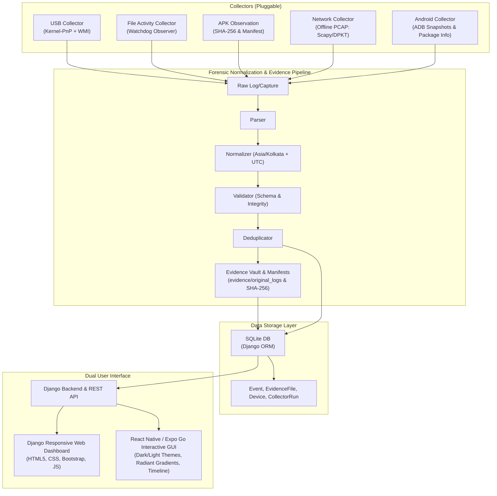

# Stage 1: Environment Inspection & Diagnostic Report

**Project Title:** HPC-Accelerated AI-Enhanced Digital Forensics and Behavioral Analysis System  
**System Architecture:** Windows 11 Home 64-bit | Node.js v24.14.0 | Python 3.14.2 | Android SDK & ADB  
**Date:** November 6, 2026  

---

## 1. Environment Detection & Tool Audit

| Software / Component | Detected Version / Path | Status | Required Action / Verification Result |
| :--- | :--- | :--- | :--- |
| **Operating System** | Windows 11 Home Single Language (Build 26300, 64-bit AMD64) | **Available** | Verified via `Win32_OperatingSystem`. |
| **Storage: Drive C** | 3.55 GB Free / 247.7 GB Used | **Warning: Low** | Keep workspace and virtual caches strictly on Drive D. |
| **Storage: Drive D** | 95.05 GB Free / 4.95 GB Used | **Healthy** | Primary project workspace directory (`D:\Aarya\Unnamed Project`). |
| **Storage: Drive E** | 99.91 GB Free / 0.09 GB Used | **Healthy** | Available for secondary backups if needed. |
| **PowerShell** | v5.1.26100.9818 | **Available** | Verified for script automation & Windows event log harvesting. |
| **Python** | Python 3.14.2 (`C:\Python314\python.exe`) | **Available** | Verified. Python 3.14 is active. |
| **Python Virtual Env** | `.venv` (`D:\Aarya\Unnamed Project\.venv`) | **Installed** | Verified with Django 6.1.3, Watchdog 7.1.0, PyWin32 312, PyYAML 6.0.3, DPKT 1.9.8, Scapy 2.8.0, Pytest 9.2.0. |
| **Git** | `git version 2.52.0.windows.1` | **Available** | Verified. Existing repository detected. User identity preserved without fabrication. |
| **Node.js & NPM** | Node v24.14.0, NPM 11.9.0 | **Available** | Verified. Ready for Expo Go & React Native Interactive GUI. |
| **Android Studio & SDK** | `C:\Program Files\Android` & `C:\Users\AASTHA\AppData\Local\Android\Sdk` | **Available** | SDK, platform-tools, emulator, and system-image (android-36.1 google_apis_playstore x86_64) detected. |
| **ADB (Platform Tools)** | `C:\Users\AASTHA\AppData\Local\Android\Sdk\platform-tools\adb.exe` | **Available** | Verified v1.0.41 (v36.0.2). Daemon started cleanly on tcp:5037. |
| **Android Virtual Device**| `emulator.exe -list-avds` returned empty | **Pending Creation**| System image ready; AVD creation to be guided safely. |
| **Wireshark / TShark** | Missing in PATH | **Alternative Ready** | Offline PCAP/PCAPNG parsing enabled via pure Python (`scapy` + `dpkt`). Live capture with Wireshark/Npcap requires admin approval. |
| **Windows USB / PnP Logs** | Kernel-PnP, UserPnp, Storage-ClassPnP | **Available** | Verified `Microsoft-Windows-Kernel-PnP/Device Management` (4,687 records) and `Win32_PnPEntity` WMI queries. |

---

## 2. Windows USB / PnP Discovery Details

Windows Event Log inspection revealed:
1. `Microsoft-Windows-Kernel-PnP/Device Management`: **Enabled** (4,687 events). Logs device arrivals and removals with hardware IDs and vendor strings.
2. `Microsoft-Windows-Kernel-PnP/Configuration`: **Enabled** (1,172 events). Logs driver binding and configuration changes.
3. `Microsoft-Windows-UserPnp/DeviceInstall`: **Enabled** (549 events). Logs user-mode device installation events.
4. `Microsoft-Windows-Storage-ClassPnP/Operational`: **Enabled** (421 events). Captures USB Mass Storage class devices.
5. `Microsoft-Windows-DriverFrameworks-UserMode/Operational`: **Disabled** by default in Windows 11 Home (requires admin privilege to enable via `wevtutil`).
6. **WMI/CIM `Win32_PnPEntity` & `Win32_USBHub`**: Fully accessible in real-time without administrative privileges.

---

## 3. High-Level System Architecture

---

## 4. Phase Implementation Sequence (Strict Roadmap)

1. **Phase 1: Environment & Project Setup** *(In Progress)*:
   - Configure `.venv`, `requirements.txt`, installation scripts, `.gitignore`, settings configuration, and directory layout.
2. **Phase 2: USB Collector**:
   - Query `Microsoft-Windows-Kernel-PnP/Device Management` and WMI `Win32_PnPEntity` for connection/disconnection events.
3. **Phase 3: File Monitoring**:
   - Watch `test_data/watched_downloads/` using Python `watchdog`, wait for file write completion, compute SHA-256.
4. **Phase 4: APK File Observation**:
   - Detect APK files in watched folder, calculate hashes, extract package metadata, generate `apk_file_observed`.
5. **Phase 5: Android Emulator Monitoring**:
   - Interface with ADB (`adb.exe`), capture before/after package snapshots, observe controlled harmless APK installations.
6. **Phase 6: Network Collector**:
   - Import PCAP/PCAPNG using `dpkt` / `scapy`, extract IP, port, protocol, packet length, TCP flags, DNS metadata.
7. **Phase 7: Centralized Event Pipeline**:
   - Parser, Normalizer, Validator, Deduplicator conforming to Common Event Schema.
8. **Phase 8: Forensic Evidence Management**:
   - Unique Evidence IDs, original file preservation, SHA-256 integrity verification, manifests.
9. **Phase 9: SQLite Database & Django ORM**:
   - Django models, migrations, indexes, repositories, transaction safety.
10. **Phase 10: Unified Chronological Timeline**:
    - Multi-source chronological view, filters, pagination, CSV export, evidence traceability.
11. **Phase 11: Django Web Dashboard & React Native / Expo Go GUI**:
    - Django responsive web dashboard.
    - React Native / Expo Go mobile & desktop interactive GUI featuring dark/light theme gradients, animated metric widgets, filterable timeline, and collector controls.
12. **Phase 12: Testing & Stage 1 Completion Report**:
    - Automated unit tests, integration tests, manual testing guides, limitation disclosures, and final documentation.
