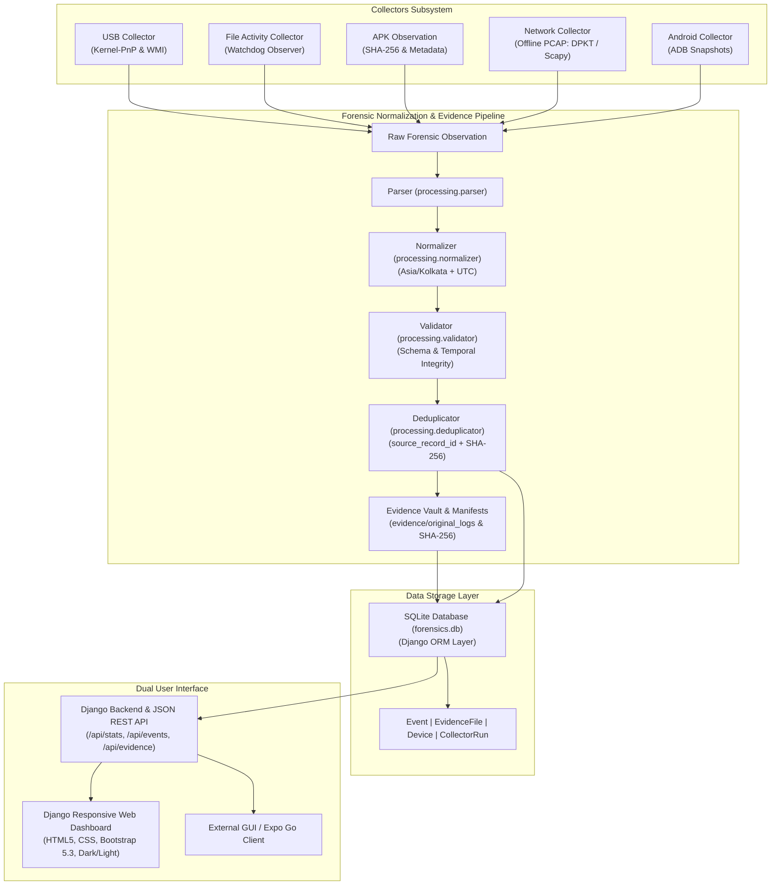

# Architecture Reference — HPC-Accelerated AI-Enhanced Digital Forensics and Behavioral Analysis System (Stage 1)

## 1. System Overview

Stage 1 establishes the forensic data ingestion foundation, event normalization pipeline, cryptographic chain-of-custody vault, and multi-source chronological timeline visualization for the digital forensics system.

Stage 1 is strictly scoped to metadata collection, validation, timeline reconstruction, and evidence integrity verification. It does not perform AI classification, automated malware execution, or network packet injection.

---

## 2. Component Architecture

### 2.1 Pluggable Collector Layer (`collectors/`)
All collectors derive from the abstract base class `BaseCollector` in `collectors/base_collector.py`.
- **Lifecycle Interface**: `initialize()`, `start()`, `stop()`, `get_status()`, `report_error()`.
- **Audit Integration**: Automatically records each collection session in the `collector_runs` table (`CollectorRun` model).
- **Thread Safety**: Each collector runs in an isolated, monitored background daemon thread with mutex locks protecting internal counters.

### 2.2 Forensic Normalization & Validation Pipeline (`processing/`)
1. **Parser (`processing/parser.py`)**: Accepts raw collector dictionaries and converts them into standardized internal dictionaries without data loss.
2. **Normalizer (`processing/normalizer.py`)**: Converts timestamps to UTC-aware `datetime` objects, preserves original timezone information, maps legacy or raw aliases to canonical event types, and normalizes device and source strings. **Forensic Rule**: Never fabricates missing or unparseable timestamps into the current time.
3. **Validator (`processing/validator.py`)**: Verifies presence of mandatory schema fields (`event_timestamp`, `event_type`, `source`, `collector_name`), checks for temporal drift (>5 min future or >5 yr past), and assigns a validation status (`valid`, `warning`, `invalid`).
4. **Deduplicator (`processing/deduplicator.py`)**: Enforces two-tier deduplication:
   - Primary: `source_record_id` + `collector_name` uniqueness.
   - Secondary: Cryptographic `SHA-256` deduplication for file and evidence artifacts.

### 2.3 Data Storage Layer (`database_app/`, `database/`)
- Built upon **Django ORM** backed by a local **SQLite** database (`forensics.db`).
- Schema indexes optimized for timeline traversal:
  - `(event_timestamp, event_type)`
  - `(source, collector_name)`
  - `(collector_name, source_record_id)`
  - `(evidence_type, sha256_hash)`
- Repository pattern implemented in `database/repositories.py` (`EventRepository`, `EvidenceRepository`, `CollectorRunRepository`) ensuring separation of concerns.

### 2.4 User Interface Layer (`dashboard/`, `api_app/`)
- **Django Server-Rendered UI**: 9 dedicated views rendered with Bootstrap 5.3 and responsive CSS in `dashboard/templates/dashboard/`.
- **JSON REST API**: Endpoints in `api_app/views.py` allowing headless consumption and real-time polling by external clients.

