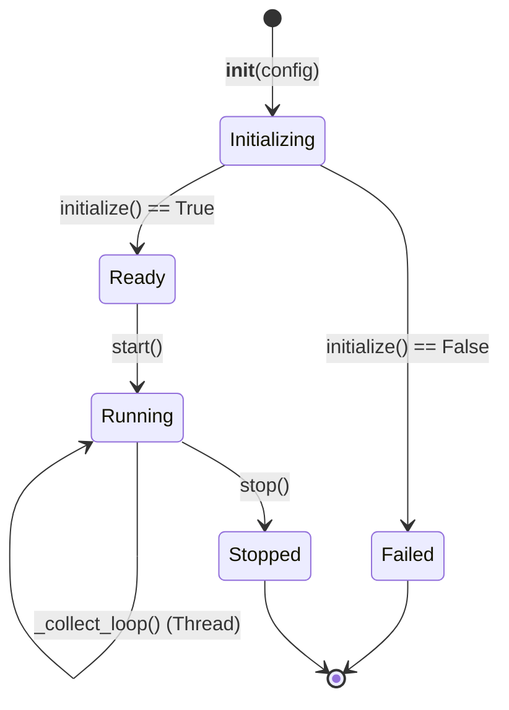

# Collector Architecture & Lifecycle — Stage 1

All forensic collectors implement a common architecture defined in `collectors/base_collector.py`.

---

## 1. Collector Lifecycle

Each collector operates as an independent, non-blocking background service:

### Key Methods
- `initialize() -> bool`: Verifies prerequisites (e.g., checks library availability, creates watch directories, tests tool binaries). Returns `False` if prerequisites are not met.
- `start()`: Launches `_collect_loop` inside a background daemon thread, creates an active `CollectorRun` record in SQLite, and transitions state to `is_running = True`.
- `stop()`: Signals the collection thread to terminate gracefully, awaits thread join (up to 10 seconds), updates the `CollectorRun` record with `end_time`, `completed` status, and total collected event counts.
- `get_status() -> dict`: Returns an operational dictionary for telemetry display on the dashboard.
- `report_error(message, exception=None)`: Logs the error, updates internal failure counters, and appends the diagnostic message to the active `CollectorRun` database audit log.

---

## 2. Pluggable Collectors

### 2.1 `USBCollector` (`collectors/usb_collector.py`)
- **Channel**: `Microsoft-Windows-Kernel-PnP/Device Management` (via `win32evtlog`).
- **Events Detected**:
  - Connection: Event IDs 400, 410, 420 (`usb_connected`).
  - Disconnection: Event IDs 430, 440 (`usb_disconnected`).
- **Metadata Extraction**: Vendor ID (VID) and Product ID (PID) extracted via regex from device strings.
- **Deduplication**: `source_record_id` based on channel record numbers.

### 2.2 `FileCollector` (`collectors/file_collector.py`)
- **Library**: `watchdog.observers.Observer` + `FileSystemEventHandler`.
- **Monitored Scope**: Dedicated directory `test_data/watched_downloads/`.
- **Temporal Stability**: Calls `wait_for_stability()` to ensure file writes are complete before computing SHA-256 and emitting events.
- **Temporary File Handling**: Ignores `.crdownload`, `.part`, `.tmp`, `.partial` until final rename.
- **APK Differentiation**: Emits `apk_file_observed` for `.apk` extensions, creating a corresponding `EvidenceFile` record. **Never executes the APK**.

### 2.3 `NetworkCollector` (`collectors/network_collector.py`)
- **Offline Parsing**: Pure Python PCAP and PCAPNG parsing via `dpkt` library (with `scapy` fallback).
- **Packet Metadata**: Extracts Frame Number, UTC Timestamp, Source/Destination IPv4/IPv6, Source/Destination Ports, Protocol (TCP, UDP, ICMP), TCP Flags (SYN, ACK, FIN, RST), and DNS Queries.
- **Evidence Preservation**: PCAP files are hashed (SHA-256), assigned an `evidence_id`, and packet events reference the underlying evidence.

### 2.4 `AndroidCollector` (`collectors/android_collector.py`)
- **Tooling**: Interfaces with Android Debug Bridge (`adb.exe`).
- **Device Discovery**: Executes `adb devices` to identify active emulators (`emulator-5554`).
- **Controlled Package Monitoring**: Runs `adb shell pm list packages -3` to capture baseline snapshots and compares before/after snapshots to detect newly installed packages.
- **Safety Boundary**: Never connects to or modifies the user's personal Android phone.

