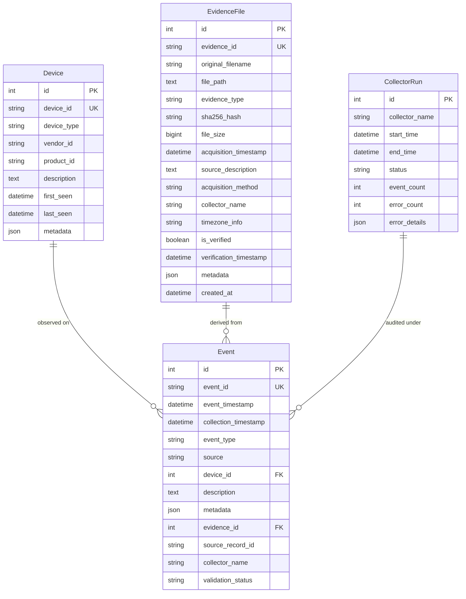

# Database Schema & Data Models — Stage 1

Stage 1 utilizes an SQLite database (`forensics.db`) managed via Django ORM with explicit indexing, transactions, and foreign key integrity.

---

## 1. Entity Relationship Overview

---

## 2. Table Specifications

### 2.1 `devices` (`database_app.models.Device`)
Represents physical, virtual, or network devices observed during forensic collection.
- `device_id` (CharField, max 512, unique, indexed): Unique hardware string, e.g. `USB\VID_0781&PID_5583\4C53000...` or `android:emulator-5554`.
- `device_type` (CharField, max 100): Categorization (`usb`, `android_emulator`, `network_host`).
- `vendor_id` (CharField, max 20): Hexadecimal vendor ID (e.g. `0781`).
- `product_id` (CharField, max 20): Hexadecimal product ID (e.g. `5583`).
- `description` (TextField): Descriptive vendor label or product name.
- `first_seen` / `last_seen` (DateTimeField): Timestamps tracking device persistence.
- `metadata` (JSONField): Arbitrary device properties.

### 2.2 `evidence_files` (`database_app.models.EvidenceFile`)
Maintains chain-of-custody records for every imported file, network capture, or log export.
- `evidence_id` (CharField, max 32, unique, indexed): Formatted identifier, e.g. `EVD-49C4E5075777`.
- `original_filename` (CharField, max 512): Original file name at acquisition.
- `file_path` (TextField): Disk location of preserved original evidence.
- `evidence_type` (CharField, max 20): Type classification (`pcap`, `apk`, `log`, `event_log`, `file`, `other`).
- `sha256_hash` (CharField, max 64, indexed): Cryptographic hash computed upon acquisition.
- `file_size` (BigIntegerField): Size in bytes.
- `acquisition_timestamp` (DateTimeField): UTC timestamp of acquisition.
- `is_verified` (BooleanField): Status of cryptographic re-verification.
- `verification_timestamp` (DateTimeField): When hash integrity was last re-calculated.

### 2.3 `events` (`database_app.models.Event`)
Unified forensic event table capturing observations across all 4 collector sources.
- `event_id` (CharField, max 32, unique, indexed): Formatted identifier, e.g. `EVT-D2B014E72A84`.
- `event_timestamp` (DateTimeField, indexed): Actual time event occurred at source (UTC-aware).
- `collection_timestamp` (DateTimeField): Time event was ingested by the collector pipeline.
- `event_type` (CharField, max 40, indexed): Canonical event type:
  - `usb_connected`, `usb_disconnected`
  - `file_created`, `file_modified`, `file_moved`, `file_download_observed`
  - `apk_file_observed`, `apk_installed`, `android_package_observed`
  - `network_packet`
- `source` (CharField, max 200, indexed): Event source identifier (e.g. `pcap:capture.pcap`, `watchdog:test_data/watched_downloads`).
- `device_id` (ForeignKey -> Device, nullable): Associated device entity.
- `evidence_id` (ForeignKey -> EvidenceFile, nullable): Link to underlying evidence file.
- `source_record_id` (CharField, max 256, indexed): Unique record identifier from original source (e.g. `pcap:capture.pcap:frame1`, `PnP#1001`).
- `collector_name` (CharField, max 100): Originating collector (`USBCollector`, `FileCollector`, `NetworkCollector`, `AndroidCollector`).
- `validation_status` (CharField, max 20, indexed): Status (`valid`, `invalid`, `warning`, `pending`).
- `metadata` (JSONField): Collector-specific payload metadata.

### 2.4 `collector_runs` (`database_app.models.CollectorRun`)
Audit log for collector execution sessions.
- `collector_name` (CharField, max 100, indexed)
- `start_time` / `end_time` (DateTimeField)
- `status` (CharField, max 20): Choice (`running`, `completed`, `failed`, `stopped`).
- `event_count` (IntegerField): Total events collected during session.
- `error_count` (IntegerField): Total errors logged during session.
- `error_details` (JSONField): Diagnostic stack traces or error messages.

