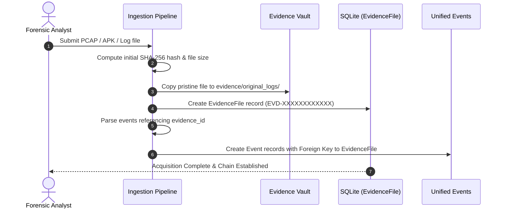

# Forensic Evidence Integrity & Custody Guide — Stage 1

This document explains cryptographic evidence hashing, chain-of-custody tracking, and integrity verification.

---

## 1. Evidence Vault Architecture

Original evidence must remain pristine and un-mutated. Stage 1 maintains strict directory separation:

```
evidence/
├── original_logs/     # Bit-for-bit pristine original evidence files (read-only)
├── manifests/         # Cryptographic checksum manifests and acquisition metadata
└── processed/         # Working copies used for normalizer and parser pipelines
```

---

## 2. Chain-of-Custody Acquisition Workflow

When an evidence file is introduced into the system:



---

## 3. Cryptographic Verification Algorithm

Verification recalculates the SHA-256 hash of the evidence file on disk and compares it to the hash recorded at acquisition:

```python
import hashlib

def verify_file_integrity(file_path: str, stored_hash: str) -> bool:
    h = hashlib.sha256()
    with open(file_path, 'rb') as f:
        for chunk in iter(lambda: f.read(65536), b''):
            h.update(chunk)
    computed_hash = h.hexdigest()
    return computed_hash == stored_hash
```

### Verification States:
- **Verified (`is_verified = True`)**: The file on disk exactly matches the original acquisition hash byte-for-byte.
- **Tampered / Corrupted (`is_verified = False`)**: The computed hash does not match the stored hash, indicating file modification, truncation, or corruption.
- **Missing (`error: File not found`)**: The file at the recorded path has been deleted or moved.

---

## 4. Verifying Evidence via Dashboard & API

### Web Interface:
1. Navigate to `http://127.0.0.1:8000/evidence/`.
2. Locate the evidence item in the table.
3. Click the **Verify Hash** button.
4. The system recalculates the SHA-256 hash in real time, updates `is_verified` and `verification_timestamp`, and displays a success alert with the verified hash.

### API Endpoint:
```http
POST /evidence/verify/<evidence_id>/
```

---

## 5. Important Legal Disclaimer

> [!NOTE]
> A matching SHA-256 hash confirms only that the file content has not changed since the initial timestamp of acquisition by this software. It does not independently verify the provenance, legal authenticity, or chain-of-custody prior to ingestion. This software is a digital forensics analysis system, not a legally certified judicial acquisition suite.

